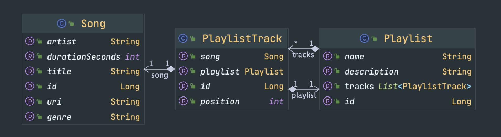
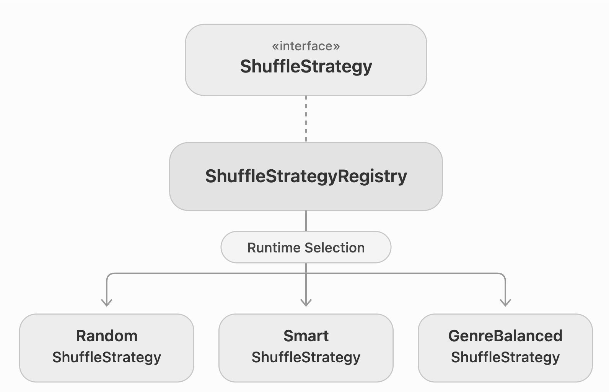

## 1. Overview

A RESTful API for music playlist management built with Java and Spring Boot.

The application provides playlist management, multiple shuffle algorithms, content-based recommendations, multi-format playlist export, and centralized playback control.

The project is designed with a focus on the following technical objectives:

- Object-oriented design, SOLID principles, and design patterns
- Runtime-selectable algorithms and extensible architecture
- Thread-safe management of shared playback state
- Unit and integration testing of core business logic

The application manages music metadata and playback state only, without actual audio streaming.

<br>

## 2. Features

| Feature | Description |
|---|---|
| Playlist Management | CRUD operations, dynamic song addition and removal, track reordering |
| Shuffle | Random, Smart, Genre-balanced |
| Recommendation | Song recommendations based on genre compatibility and artist affinity |
| Export | JSON, M3U, CSV |
| Global Music Player | Centralized playback control using a thread-safe singleton |
| Multi-step Workflow | Playlist creation, addition of recommended songs, and playback initiation |

<br>

## 3. Technology Stack

- **Language:** Java 21
- **Framework:** Spring Boot 4.0.10
- **Web & Persistence:** Spring Web MVC, Spring Data JPA
- **Database:** H2 
- **Validation & Utilities:** Jakarta Bean Validation, Lombok
- **Build Tool:** Maven
- **Testing:** JUnit 5, Mockito, AssertJ, MockMvc

<br>

## 4. Getting Started

The Maven Wrapper is included in the repository, so a separate Maven installation is not required.

### Build and Run

```bash
git clone https://github.com/YeowonKIM/music-playlist.git
cd music-playlist

./mvnw clean verify
./mvnw spring-boot:run
```

_On Windows, use `mvnw.cmd` instead of `./mvnw`._

**API Base URL:** `http://localhost:8080/api`

<br>

### Sample Data

The following sample data is automatically initialized at application startup, with no additional configuration required:

- 30 songs, 15 artists, and 6 genres
- 5 playlists

The application uses an H2  database. All data is reset when the application restarts.

<br>

## 5. Architecture

The application is organized into packages based on business domains and features, with a clear separation of responsibilities across layers within each package.

```text
com.example.musicplaylist
├── common
├── song
├── playlist
├── shuffle
├── recommendation
├── export
├── player
└── workflow
```

- **Controller:** HTTP request and response handling
- **Service:** Business operations and transaction management
- **Domain:** Domain models and business rules
- **Repository:** Data access and persistence
- **Strategy:**  Application of the Strategy Pattern to support interchangeable algorithms and extensible export formats.
- **DTO:** API request and response models


### Domain Model




<br>

## 6. API Specification
- **Swagger UI (Local):** [http://localhost:8080/swagger-ui.html](http://localhost:8080/swagger-ui.html)

| Category | Base Endpoint | Available Endpoints |
|---|---|---|
| Songs | /api/songs | POST /<br> GET /<br> GET /{songId} |
| Playlists | /api/playlists | POST /<br> GET /<br> GET /details<br> GET /{playlistId}<br> GET /{playlistId}/details<br> PUT /{playlistId}<br> DELETE /{playlistId}<br> POST /{playlistId}/tracks<br> DELETE /{playlistId}/tracks/{songId}<br> PATCH /{playlistId}/tracks/{songId}/position |
| Shuffle | /api | GET /shuffle/strategies<br> GET /playlists/{playlistId}/shuffle?strategy={strategy} |
| Recommendation | /api/playlists/{playlistId} | GET /recommendations?limit={limit} |
| Export | /api | GET /export/formats<br> GET /playlists/{playlistId}/export?format={format} |
| Player | /api/player | POST /play<br> POST /pause<br> POST /resume<br> POST /stop<br> POST /next<br> POST /previous<br> GET /state |
| Workflow | /api/workflows | POST /create-and-play |

- **Supported Shuffle Strategies:** random, smart, genre-balanced

- **Supported Export Formats:** json, m3u, csv

- **Default Recommendation Limit:** 10

<br>

## 7. Design Decisions

<details>
<summary><strong>Strategy Pattern & Extensibility</strong></summary>
<br>
The Strategy Pattern is applied to encapsulate shuffle algorithms, recommendation logic, and export formats behind independent interfaces.

| Interface | Implementations |
|---|---|
| `ShuffleStrategy` | Random, Smart, Genre-balanced |
| `RecommendationStrategy` | Content-based |
| `ExportStrategy` | JSON, M3U, CSV |

Shuffle and export strategies are automatically registered through Spring Dependency Injection. A Strategy Registry selects the appropriate implementation at runtime based on the incoming request.



*Shuffle Strategy Selection Example*

New shuffle algorithms and export formats can be introduced without modifying existing services, registries, or strategy implementations.

The registries remain immutable after initialization, allowing thread-safe lookups without additional synchronization.

This design follows the **Open/Closed Principle (OCP)** and the **Dependency Inversion Principle (DIP)**, promoting extensibility, loose coupling, and maintainability.

</details>

<details>
<summary><strong>Singleton & Thread Safety</strong></summary>
<br>
`MusicPlayer` is implemented as a Spring-managed Singleton Component, sharing a global playback state within a single Application Context.

To ensure state consistency across concurrent requests, the following techniques are applied:

- **Synchronization:** Mutual exclusion and memory visibility through `synchronized`.
- **Immutable State:** Consistent state management through an immutable `PlaybackState`.
- **Defensive Copy:** Protection of the playback queue against external modifications.

Database queries and shuffle computations are performed outside the synchronized blocks to minimize the scope of synchronization.

Since the current requirements do not require advanced locking mechanisms, `synchronized` was chosen for its simplicity and maintainability.

</details>

<details>
<summary><strong>Service Composition & Transaction Management</strong></summary>
<br>
Playlist creation, the addition of recommended songs, and playback initiation are combined into a single workflow.

Existing services are reused, and `TransactionTemplate` is used to explicitly manage the transaction boundaries of database operations.

If any database operation fails, all changes within the transaction are rolled back. In the REST workflow, the `MusicPlayer` state is updated only after the database transaction has been successfully committed.

This prevents database failures from resulting in an inconsistent playback state.

</details>

<details>
<summary><strong>Domain Modeling & Object Creation</strong></summary>
<br>
The Static Factory Method, Builder Pattern, and encapsulation are applied to control object creation and state modifications.

- **Static Factory Method:** `Playlist.of()` and `PlaylistTrack.of()` provide explicit object creation methods while restricting direct access to constructors.
- **Builder Pattern:** `Song.builder()` provides a readable way to initialize multiple metadata fields while excluding the persistence identifier (ID) from the object creation process.
- **Encapsulation:** State modifications and business rules are managed through explicit domain methods such as `addSong()`, `removeSong()`, and `moveSong()` rather than public setters.
- **Defensive Copy:** Internal collection state is protected against external modifications.

These approaches improve readability, maintainability, and the protection of domain invariants.

</details>

<br>

## 8. Algorithms

<details>
<summary><strong>Shuffle Algorithms</strong></summary>
<br>

| Algorithm | Approach | Time Complexity |
|---|---|---|
| Random Shuffle | Java's built-in shuffle algorithm | O(n) |
| Smart Shuffle | Artist grouping and Priority Queue | O(n log(a + 1)) |
| Genre-balanced Shuffle | Genre grouping and Round-robin | O(n) |

Where `n` is the number of songs and `a` is the number of distinct artists.

All shuffle algorithms preserve the original playlist order and return a newly ordered list of songs without modifying the original playlist.

</details>

<details>
<summary><strong>Recommendation Algorithm</strong></summary>
<br>

The content-based recommendation algorithm calculates a relevance score for each candidate song based on two weighted factors:

- **Genre Compatibility (70%):** Compatibility between the candidate song's genre and the genre distribution of the playlist.
- **Artist Affinity (30%):** The relative frequency of the candidate song's artist within the playlist.

The highest-ranked songs are returned according to the requested recommendation limit.

</details>


<br>

## 9. Testing

Unit and integration tests focus on core business logic and key technical requirements.

| Category | Test Coverage |
|---|---|
| Domain | Duplicate prevention, song addition and removal, track reordering |
| Shuffle | Song preservation, minimization of artist repetition, genre distribution |
| Recommendation | Score calculation, ranking, candidate filtering |
| Export | Format-specific output, special character handling |
| Music Player | State transitions, immutability, concurrent access |
| Workflow | Multi-step operations, transaction rollback, playback state preservation |
| REST API | Request validation, exception handling |

The testing approach prioritizes business-critical behavior, algorithm correctness, and shared state consistency.

<br>

## 10. Limitations & Future Improvements

| Current Implementation | Future Improvements |
|---|---|
| H2 in-memory database | Migration to PostgreSQL or Oracle |
| synchronized-based concurrency control | Consider `ReentrantLock` if advanced locking features are required |
| Concurrent playlist modifications | Introduce conflict management through Optimistic Locking |
| Fixed recommendation weights and genre compatibility scores | Externalize configuration, incorporate user feedback, and analyze listening patterns |

<details>
<summary><strong>Database Migration</strong></summary>
<br>
The application currently uses an H2 in-memory database to simplify execution and testing without requiring an external database installation.

Since the persistence layer is built on Spring Data JPA, the application can migrate to PostgreSQL or Oracle while retaining the existing architecture, subject to database-specific configuration and compatibility testing.

</details>

<details>
<summary><strong>Advanced Concurrency Control</strong></summary>
<br>
The current `MusicPlayer` implementation uses `synchronized` and immutable state objects to ensure state consistency across concurrent requests.

This approach is simple, maintainable, and sufficient for the current requirements. However, `ReentrantLock` could be considered if the following advanced locking capabilities become necessary:

- **Timed Lock Acquisition:** Acquire a lock within a specified timeout.
- **Interruptible Lock Acquisition:** Allow threads waiting for a lock to respond to interruptions.
- **Fairness Policy:** Provide greater control over the fairness of lock acquisition.

</details>

<details>
<summary><strong>Concurrent Playlist Modifications</strong></summary>
<br>
The current concurrency control mechanism primarily focuses on the shared playback state managed by `MusicPlayer`.

When multiple requests simultaneously add, remove, or reorder tracks within the same playlist, conflicting modifications or lost updates may occur.

To address this limitation, Optimistic Locking could be introduced. 

Pessimistic Locking could also be considered depending on the frequency of conflicts and data consistency requirements.

</details>

<details>
<summary><strong>Recommendation Algorithm Enhancement</strong></summary>
<br>
The current recommendation algorithm uses Content-based Filtering based on the genre distribution and artist frequency within a playlist.

The recommendation weights (70:30) and genre compatibility scores are arbitrarily defined and do not reflect actual user listening patterns or evolving preferences.

Potential improvements include:

- Externalizing recommendation weights and the genre compatibility matrix.
- Analyzing user listening patterns based on playback history, listening frequency, and preferred genres.

The existing `RecommendationStrategy` interface allows new recommendation algorithms to be introduced while preserving the overall structure of the recommendation service.

</details>

<br>